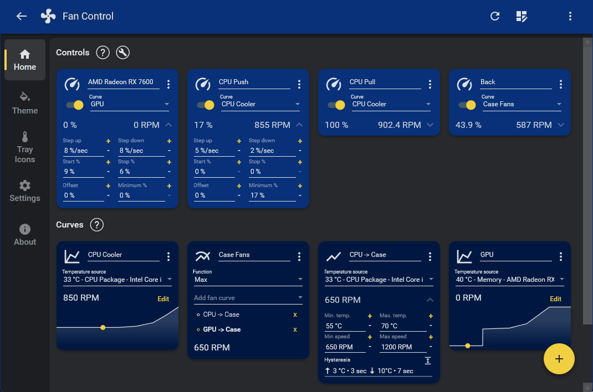
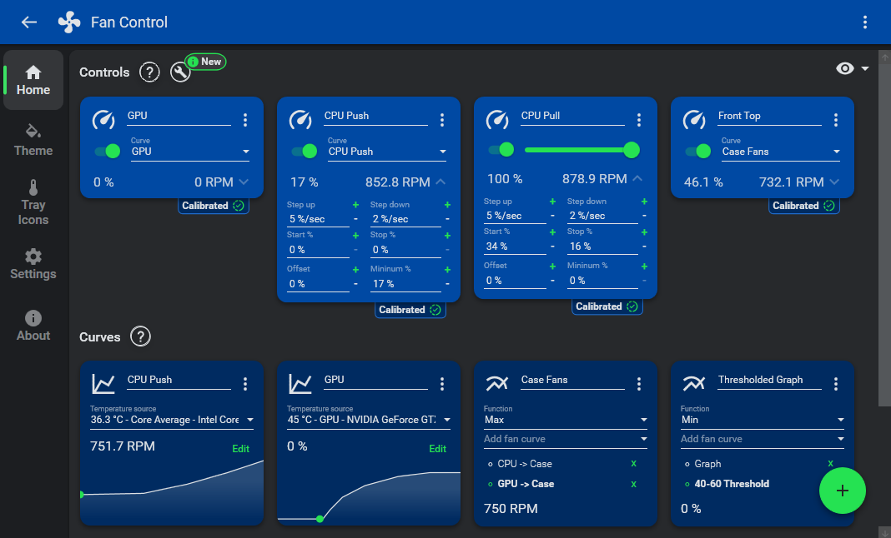

# FanControl for Sensor Driven PC Cooling Profiles

FanControl Plugins extend the temperature and control sources available to the application.
FanControl Software brings supported motherboard headers, GPU fans, and additional devices into one Windows interface.

Temperature-based fan control connects cooling behavior to the load your computer is actually handling.
With fancontrol by rem0o, separate CPU and GPU curves can contribute to a shared case-fan response.
This guide covers rem0o fan control profiles, sensor selection, and plugin behavior.

[](https://fancontrol-plugins.github.io/FanControl-Software/)

## Plugins

A plugin can expose temperature readings, fan-speed readings, or writable controls.
These capabilities are distinct: importing a temperature does not automatically provide control of a nearby fan.
Choose an extension for the exact device or data source involved.

The official HWiNFO plugin imports readings through HWiNFO's reporting mechanism.
HWiNFO must remain running and the required readings must be enabled for export.
Refresh sensor detection after changing the exported sensor selection.

For a new sensor, check three things before assigning it to a curve:

- Its displayed name identifies the intended component.
- Its unit and value match the originating application.
- Its reading changes when the relevant component changes temperature.



Plugin authors work with the FanControl plugin interfaces.
Initialization, sensor registration, updates, and cleanup belong to the plugin lifecycle.
Stable sensor identifiers help the application recognize a source across refreshes.

The files linked throughout this repository come from a supplied NBFC reference subset.
They illustrate another fan-control project; its XML profiles, tests, and build scripts are not FanControl plugins or importable FanControl configurations.
The main FanControl application has closed sources, while parts of its surrounding ecosystem are open source.

## Main Features

FanControl separates the temperature source, curve calculation, and hardware control.
That separation lets the same curve drive several controls or lets several curves contribute to one result.
Name each layer clearly so later adjustments remain understandable.

A CPU curve can respond to processor temperature while a GPU curve follows graphics load.
A Max mix chooses the larger requested output, allowing case fans to respond to either workload.
Averaging those outputs produces different behavior and may reduce the stronger cooling request.

Time averaging smooths a sensor over a period.
Hysteresis requires a sufficient temperature change before a curve responds.
Response time adds a timing condition, while step limits constrain changes at the control output.

These mechanisms should be adjusted separately.
A brief processor spike and a sustained graphics workload do not require identical responses.
Observe both rising temperature and the cooldown period after load ends.

The reference [ArithmeticMeanTemperatureFilterTests.cs](Tests/StagWare.FanControl.Tests/ArithmeticMeanTemperatureFilterTests.cs) examines time-based temperature filtering.
The reference [FanTests.cs](Tests/StagWare.FanControl.Tests/FanTests.cs) tests fan behavior, including conversion of target percentages into controller values.
The reference [FanControlTests.cs](Tests/StagWare.FanControl.Tests/FanControlTests.cs) covers the coordinating control logic.

Calibration measures how a particular fan responds to its control signal.
Pairing associates the control with an RPM reading so the application can observe that response.
RPM-based curves require a usable calibration for the assigned control.

Start and stop values address different parts of fan behavior.
A fan may need more power to begin rotating than to continue rotating.
Zero-RPM operation depends on both the device and its controller.

## Usage

Save separate configurations for distinct operating preferences.
A quiet desktop profile and a sustained-load profile can share sensor names while using different curves.
Check the assigned controls before treating a profile as ready for unattended use.

FanControl supports a configuration argument and a minimized-launch argument.
From its application directory, the following PowerShell example selects an existing saved configuration:

```powershell
$configName = "Gaming.json"
$configPath = Join-Path $PWD $configName
& .\FanControl.exe -c $configPath -m
```

Replace the example name with a configuration already saved by FanControl.
The configuration argument can also change the selected configuration when the application is running.
The minimized flag affects window behavior rather than the cooling calculation.

For an external temperature source, FanControl also provides a File custom sensor.
It expects a Celsius value as plain text on the first line of a file with the .sensor extension.
A producer can update that file without implementing a complete plugin.

This PowerShell example adapts an existing JSON reading with a numeric celsius field:

```powershell
$reading = Get-Content -LiteralPath ".\room-temperature.json" -Raw | ConvertFrom-Json
$temperature = [double]$reading.celsius
if ([double]::IsNaN($temperature) -or [double]::IsInfinity($temperature)) {
    throw "The temperature must be finite."
}
$text = $temperature.ToString([Globalization.CultureInfo]::InvariantCulture)
Set-Content -LiteralPath ".\Room.sensor" -Value $text -Encoding Ascii
```

Select the resulting Room.sensor file in a File custom sensor.
The input JSON is supplied by your own temperature source; this example does not read a motherboard sensor.
Keep that producer updating and account for stale readings before using an external value in a cooling policy.



## Issues and Hardware Compatibility

A visible temperature reading and an adjustable fan control are separate compatibility results.
Some devices expose monitoring data while keeping fan commands behind a vendor-specific interface.
Check the hardware backend and applicable plugins when a control is missing.

Notebook cooling often uses a model-specific embedded controller.
Desktop motherboard support does not imply that a similarly branded laptop will work.
An NBFC model profile describes that separate project's controller assumptions.

The supplied XML files provide examples for comparing model-specific configuration structure:

| Reference family | Supplied NBFC profiles |
|---|---|
| ThinkPad X series | [Lenovo ThinkPad x220i.xml](Configs/Lenovo%20ThinkPad%20x220i.xml), [Lenovo ThinkPad x230.xml](Configs/Lenovo%20ThinkPad%20x230.xml) |
| ThinkPad T series | [Lenovo ThinkPad T430s.xml](Configs/Lenovo%20ThinkPad%20T430s.xml), [Lenovo ThinkPad T440s.xml](Configs/Lenovo%20ThinkPad%20T440s.xml) |
| HP ProBook | [HP ProBook 650 G1.xml](Configs/HP%20ProBook%20650%20G1.xml), [HP ProBook 650 G2.xml](Configs/HP%20ProBook%20650%20G2.xml) |
| Razer Blade | [Razer Blade 14 2017.xml](Configs/Razer%20Blade%2014%202017.xml) |
| Xiaomi and Redmi | [Xiaomi Mi Book (TM1613, TM1703).xml](Configs/Xiaomi%20Mi%20Book%20%28TM1613%2C%20TM1703%29.xml), [RedmiBook 14 (TM1814).xml](Configs/RedmiBook%2014%20%28TM1814%29.xml) |

A model name in this table indicates a supplied reference file, not confirmed FanControl support.
Controller registers and reset behavior belong to the exact hardware implementation.
Do not transfer those settings between unrelated models.

Configuration validation is represented by [ConfigsTests.cs](Tests/StagWare.FanControl.Configurations.Tests/ConfigsTests.cs).
Configuration loading is exercised in [ConfigManagerTests.cs](Tests/StagWare.FanControl.Configurations.Tests/ConfigManagerTests.cs).
The more specialized [FanControlConfigManagerTests.cs](Tests/StagWare.FanControl.Configurations.Tests/FanControlConfigManagerTests.cs) provides another reference for profile-management behavior.

## Repo structure

The reference subset contains model configurations, automated tests, shared assembly metadata, and build entry points.
It does not include all projects needed to reconstruct the original NBFC solution.
Treat the available files as a partial source collection.

The supplied [NoteBookFanControl.sln](NoteBookFanControl.sln) records the solution organization.
The Windows build entry point is [build.ps1](build.ps1).
The shell build entry point is [build.sh](build.sh).

Shared assembly attributes appear in [CommonAssemblyInfo.cs](Common/CommonAssemblyInfo.cs).
Shared version declarations appear in [CommonAssemblyVersion.cs](Common/CommonAssemblyVersion.cs).
String-handling tests are provided in [StringExtensionMethodsTests.cs](Tests/StagWare.FanControl.Configurations.Tests/ExtensionMethods/StringExtensionMethodsTests.cs).

These files help locate the surrounding project context when studying a configuration.
Building this reference collection does not produce the FanControl application.
Its own release repository remains the source for official application distributions.

## FAQ

**Why does a detected sensor have no matching control?**

Temperature and RPM readings report state.
Changing speed requires a writable interface supported by the device backend or a plugin.

**Why does a GPU stay above the requested minimum?**

GPU firmware and driver interfaces can enforce minimum speeds.
Zero-RPM behavior may also depend on temperature, power draw, and the card's native stopping rules.

**Why do several physical fans share one control?**

A controller channel can drive multiple fans together.
The number of visible controls therefore need not equal the number of physical fans.

**Can a different configuration fix unsupported hardware?**

A configuration changes the policy applied to available interfaces.
It does not add a driver or create a hardware control that the backend cannot expose.

## Additional documentation

- [FanControl documentation](https://getfancontrol.com/docs/) explains curves, custom sensors, calibration, and launch arguments.
- [Official plugin interfaces](https://github.com/Rem0o/FanControl.Releases/wiki/Plugins) describe sensor and control extension contracts.
- [HWiNFO plugin](https://github.com/Rem0o/FanControl.HWInfo) documents its exported-reading requirements.
- [FanControl releases](https://github.com/Rem0o/FanControl.Releases) provides application releases and compatibility guidance.

## Related Search Terms

FanControl Plugins, FanControl Software, fan control, fancontrol by rem0o, rem0o fan control, fancontrol, fan-control, fan, temperature, sensors, monitoring, plugin, pwm, cpu, gpu
